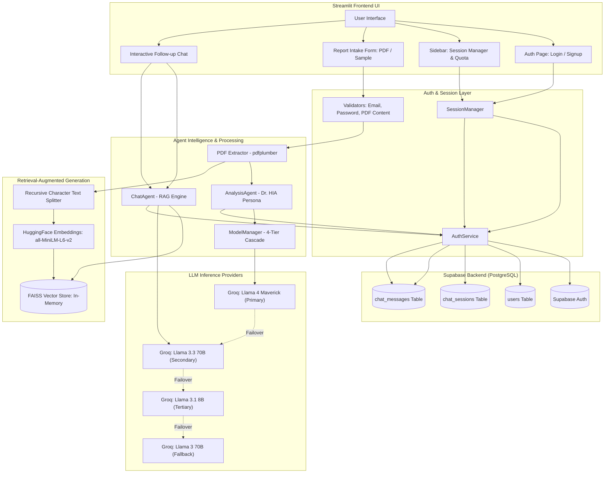
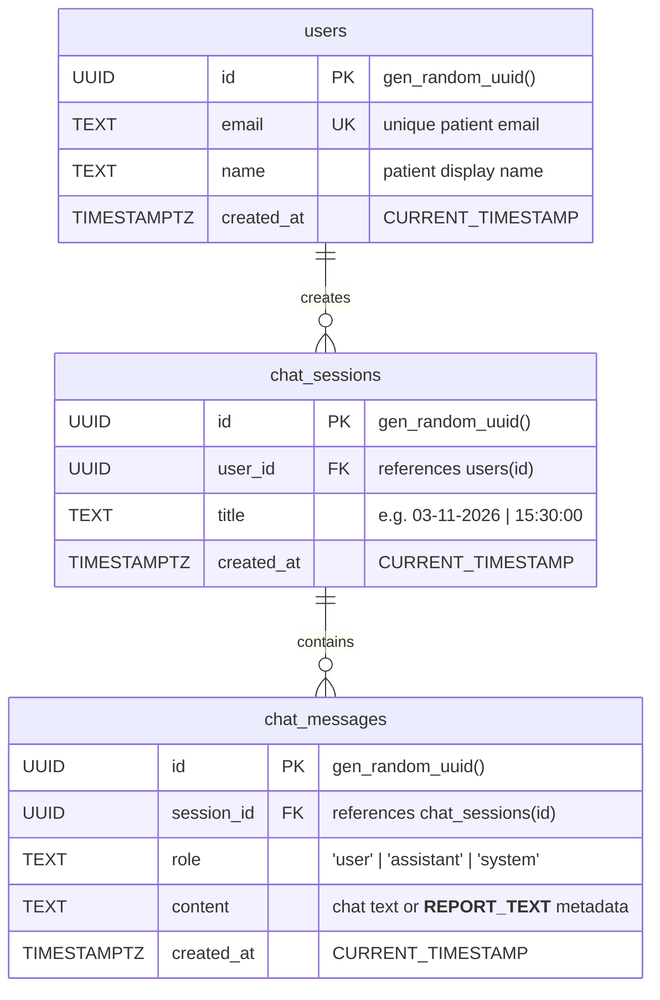

# 🩺 HIA — Health Insights Agent

> **Autonomous Clinical Intelligence Platform for Blood Report Analysis & Conversational Patient Advocacy**

[](https://www.python.org/)
[](https://streamlit.io/)
[](https://groq.com/)
[](https://supabase.com/)
[](https://www.langchain.com/)
[](https://github.com/facebookresearch/faiss)
[](LICENSE)

---

## 📑 Table of Contents

- [Overview](#-overview)
- [Key Features](#-key-features)
- [System Architecture](#-system-architecture)
- [Multi-Model Cascade Engine](#-multi-model-cascade-engine)
- [Tech Stack](#-tech-stack)
- [Database Schema & Architecture](#-database-schema--architecture)
- [Project Directory Structure](#-project-directory-structure)
- [Getting Started & Installation](#-getting-started--installation)
  - [Prerequisites](#prerequisites)
  - [1. Clone Repository](#1-clone-repository)
  - [2. Virtual Environment Setup](#2-virtual-environment-setup)
  - [3. Install Dependencies](#3-install-dependencies)
  - [4. Supabase Database Configuration](#4-supabase-database-configuration)
  - [5. Application Secrets Configuration](#5-application-secrets-configuration)
  - [6. Launch Application](#6-launch-application)
- [Usage Workflow](#-usage-workflow)
- [Configuration Reference](#-configuration-reference)
- [Security & Validation Safeguards](#-security--validation-safeguards)
- [Medical Disclaimer](#-medical-disclaimer)
- [Contributing](#-contributing)
- [License](#-license)

---

## 🔍 Overview

Laboratory blood reports are notoriously dense, technical, and intimidating for patients. Numbers, reference intervals, and clinical acronyms often leave individuals anxious and uncertain about what lifestyle, dietary, or medical steps they should actually take.

**HIA (Health Insights Agent)** bridges this gap. Powered by high-speed Groq LLM inference, local vector embeddings, and Supabase cloud persistence, HIA transforms unstructured clinical lab reports (PDFs) into clear, empathetic, and actionable medical intelligence.

Through its clinical consultant persona (**Dr. HIA**), the platform provides:
1. **Biomarker-by-Biomarker Mini-Cards**: Plain-English explanations, status severity, potential disease correlations, and specific actionable fixes.
2. **Personalized Nutrition & Lifestyle Protocols**: Exact, named foods for breakfast, lunch, and dinner (e.g., lentils, spinach, pumpkin seeds) tailored to detected deficiencies—rather than generic advice.
3. **Targeted 7-Day Fitness Routines**: Precise exercises, durations, and medical contraindications for conditions identified in the report.
4. **Longitudinal Progress Tracking**: Seamless comparison against baseline and previous analyses saved in the patient's session history.
5. **Interactive RAG Chat Consultation**: A context-grounded conversational agent powered by FAISS and HuggingFace embeddings that answers patient follow-up questions directly from their uploaded report.

---

## ✨ Key Features

### 🩺 1. Clinical Analysis Agent (Dr. HIA)
- **Zero-Jargon Communication**: Translates laboratory terminology into accessible, everyday language without compromising clinical precision.
- **Biomarker Mini-Cards**: Each abnormal test result is isolated into a structured card detailing:
  - Severity level (`URGENT` / `MODERATE` / `KEEP AN EYE ON`).
  - Plain-English analogy of what the biomarker does.
  - Most probable clinical conditions.
  - Risks of ignoring the abnormal level.
  - Specific meal recommendations and foods to strictly avoid.
  - Tailored exercise recommendations and warnings.
- **Holistic Health Synthesis**: Connects multiple interdependent markers into a unified narrative (e.g., correlating low Hemoglobin, low RBC, and low MCV to Iron Deficiency Anemia).
- **In-Context Learning (ICL)**: Dynamically indexes key biomarkers across patient demographic cohorts (`age-gender`) to refine analysis depth over time.
- **Day-One Action Checklist**: Delivers an immediate, prioritized 5-step action plan for the patient to follow today.

### 💬 2. RAG-Powered Conversational Agent
- **Semantic Report Retrieval**: Chunks extracted report text using `RecursiveCharacterTextSplitter` and embeds chunks locally using HuggingFace `all-MiniLM-L6-v2`.
- **In-Memory Vector Search**: Queries an in-memory `FAISS` index to retrieve the top matching report passages for any patient question.
- **Conversational Coreference Contextualization**: Automatically reformulates user follow-up questions by factoring in previous chat turns to resolve pronouns and implicit references before querying the vector store.
- **Graceful Context Degradation**: Automatically falls back to chat dialogue history if report context is unavailable.

### 🛡️ 3. Multi-Tier Model Resilience Cascade
- Built on Groq's high-speed inference engine with automated failover:
  - **Tier 1 (Primary)**: `meta-llama/llama-4-maverick-17b-128e-instruct`
  - **Tier 2 (Secondary)**: `llama-3.3-70b-versatile`
  - **Tier 3 (Tertiary)**: `llama-3.1-8b-instant`
  - **Tier 4 (Fallback)**: `llama3-70b-8192`
- Handles API exceptions, rate limits, and quota exhaustion with automatic backoff and transparent fallback to the next tier.

### 🔐 4. Enterprise Authentication & Session Management
- **Supabase Auth (Gotrue)**: Email and password authentication with client-side and server-side password validation (min 8 characters, uppercase, lowercase, numbers).
- **Persistent Sessions**: State synchronization between browser `localStorage` and Supabase access tokens, maintaining login across tab refreshes.
- **Session Timeout Protection**: Inactivity watchdog that automatically terminates sessions after a configurable timeout (default: 30 minutes).
- **Full History Management**: Create, switch between, and permanently delete past analysis sessions with confirmation prompts.

### 📄 5. Medical Document Processing & Validation
- **Deep Text Extraction**: Powered by `pdfplumber` to extract clean textual content from multi-page medical PDFs up to 50 pages and 20MB.
- **Medical Report Verification Heuristic**: Scans extracted text against diagnostic medical keywords (`hemoglobin`, `platelet`, `glucose`, `creatinine`, `reference range`, etc.), rejecting non-medical files or empty scans.
- **One-Click Sample Mode**: Ingests a comprehensive pre-loaded blood report (`SAMPLE_REPORT`) for testing without uploading personal files.

### ⏱️ 6. Usage Quotas & Rate Limiting
- Configurable daily analysis limits (default: 15 analyses per 24 hours).
- Live sidebar countdown displaying remaining analyses and automatic reset timing.

---

## 🏗️ System Architecture



---

## ⚡ Multi-Model Cascade Engine

To guarantee 99.9% uptime and handle strict rate limits or quota drops, `ModelManager` implements an automated four-tier fallback hierarchy:

| Tier | Role | Model Name | Provider | Max Tokens | Temperature | Ideal Use Case |
| :--- | :--- | :--- | :--- | :--- | :--- | :--- |
| **Tier 1** | Primary | `meta-llama/llama-4-maverick-17b-128e-instruct` | Groq | 2000 | 0.7 | Complex reasoning & deep structured report synthesis |
| **Tier 2** | Secondary | `llama-3.3-70b-versatile` | Groq | 2000 | 0.7 | High-accuracy medical analysis & conversational RAG |
| **Tier 3** | Tertiary | `llama-3.1-8b-instant` | Groq | 2000 | 0.7 | Ultra-low latency fallback under heavy rate limiting |
| **Tier 4** | Fallback | `llama3-70b-8192` | Groq | 2000 | 0.7 | Reliable legacy fallback tier |

---

## 🛠️ Tech Stack

| Category | Technology | Purpose |
| :--- | :--- | :--- |
| **Frontend Framework** | [Streamlit](https://streamlit.io/) (>=1.42.0) | Interactive reactive web application, state management, and custom CSS |
| **LLM Inference** | [Groq Cloud SDK](https://groq.com/) (>=0.18.0) | High-throughput, low-latency LLaMA model execution |
| **Database & Auth** | [Supabase](https://supabase.com/) / [st-supabase-connection](https://github.com/sweatybridge/st-supabase-connection) | PostgreSQL database, JWT authentication, and session persistence |
| **Authentication Client**| [Gotrue](https://github.com/supabase-community/gotrue-py) | Supabase client authentication engine |
| **Vector Search** | [FAISS CPU](https://github.com/facebookresearch/faiss) | In-memory similarity search for RAG chunks |
| **Embeddings** | [HuggingFace](https://huggingface.co/) `sentence-transformers/all-MiniLM-L6-v2` | Dense semantic vector representations of clinical text |
| **AI Orchestration** | [LangChain](https://www.langchain.com/) | Chunking, prompt contextualization, and RAG retrieval pipelines |
| **PDF Extraction** | [pdfplumber](https://github.com/jsvine/pdfplumber) (>=0.11.5) | Text and tabular extraction from multi-page medical PDFs |
| **File Verification** | [filetype](https://github.com/h2non/filetype) (>=1.2.0) | Real binary MIME-type detection and upload sanitization |

---

## 🗄️ Database Schema & Architecture

The application uses three relational tables in Supabase (PostgreSQL). The complete schema is located at [`public/db/script.sql`](public/db/script.sql).



### Table Descriptions
- **`users`**: Stores user authentication records linked to Supabase Auth UUIDs.
- **`chat_sessions`**: Tracks discrete analysis sessions per user, allowing users to switch between or delete previous reports.
- **`chat_messages`**: Stores message threads. Special `system` messages preserve extracted raw report text (`__REPORT_TEXT__`) so that the FAISS vector index can be regenerated dynamically across browser sessions.

---

## 📁 Project Directory Structure

```text
hia/
├── .devcontainer/
│   └── devcontainer.json        # Docker development container configuration
├── .github/
│   ├── ISSUE_TEMPLATE/          # Issue templates (bug report, feature request)
│   └── PULL_REQUEST_TEMPLATE/   # PR submission template
├── .streamlit/
│   ├── config.toml              # Streamlit server config (e.g., maxUploadSize = 20)
│   └── secrets.toml             # API credentials (Supabase, Groq) - Git Ignored
├── public/
│   ├── db/
│   │   ├── schema.png           # Database schema diagram
│   │   └── script.sql           # PostgreSQL table definitions & index creation
│   └── HIA_demo.gif             # Application demo walkthrough
├── src/
│   ├── main.py                  # Application entrypoint & view coordinator
│   ├── agents/
│   │   ├── analysis_agent.py    # Report analysis agent with in-context learning
│   │   ├── chat_agent.py        # RAG pipeline with FAISS & HuggingFace embeddings
│   │   └── model_manager.py     # 4-tier Groq model cascade & rate-limit handler
│   ├── auth/
│   │   ├── auth_service.py      # Supabase Auth client & database operations
│   │   └── session_manager.py   # State persistence, timeout & localStorage bridge
│   ├── components/
│   │   ├── analysis_form.py     # File uploader, sample selector & patient form
│   │   ├── auth_pages.py        # Login & Signup interactive views
│   │   ├── footer.py            # Responsive UI footer
│   │   ├── header.py            # User greeting banner
│   │   └── sidebar.py           # Session list, quota monitor & logout
│   ├── config/
│   │   ├── app_config.py        # Global constants (limits, colors, timeouts)
│   │   ├── prompts.py           # Dr. HIA clinical persona & structured prompt template
│   │   └── sample_data.py       # Built-in sample blood report text
│   ├── services/
│   │   └── ai_service.py        # High-level facade for analysis & vector store caching
│   └── utils/
│       ├── pdf_extractor.py     # PDF parsing & page limit validation
│       └── validators.py        # Input sanitization & medical content verification
├── .gitignore                   # Ignored files (secrets, virtual environments, cache)
├── CODE_OF_CONDUCT.md           # Community guidelines
├── CONTRIBUTING.md              # Contribution workflow & style guide
├── LICENSE                      # MIT Open Source License
├── README.md                    # Project documentation
└── requirements.txt             # Python package dependencies
```

---

## 🚀 Getting Started & Installation

### Prerequisites
- **Python**: Version 3.8 to 3.13 installed on your machine.
- **Groq API Key**: Obtain a free API key from the [Groq Console](https://console.groq.com/keys).
- **Supabase Account**: Create a free project at [Supabase](https://supabase.com/).

---

### 1. Clone Repository

```bash
git clone https://github.com/ZeroxxG/HIA.git
cd hia
```

---

### 2. Virtual Environment Setup

#### On macOS / Linux:
```bash
python3 -m venv venv
source venv/bin/activate
```

#### On Windows (PowerShell):
```powershell
python -m venv venv
.\venv\Scripts\Activate.ps1
```

---

### 3. Install Dependencies

```bash
pip install --upgrade pip
pip install -r requirements.txt
```

---

### 4. Supabase Database Configuration

1. Log into your [Supabase Dashboard](https://app.supabase.com/) and navigate to your project.
2. Open the **SQL Editor** from the left navigation pane.
3. Paste and execute the contents of [`public/db/script.sql`](public/db/script.sql):

```sql
-- Create users table
CREATE TABLE IF NOT EXISTS users (
    id UUID PRIMARY KEY DEFAULT gen_random_uuid(),
    email TEXT NOT NULL,
    name TEXT,
    created_at TIMESTAMPTZ DEFAULT CURRENT_TIMESTAMP
);

-- Create chat_sessions table
CREATE TABLE IF NOT EXISTS chat_sessions (
    id UUID PRIMARY KEY DEFAULT gen_random_uuid(),
    user_id UUID NOT NULL,
    title TEXT,
    created_at TIMESTAMPTZ DEFAULT CURRENT_TIMESTAMP,
    FOREIGN KEY (user_id) REFERENCES users(id) ON DELETE CASCADE
);

-- Create chat_messages table
CREATE TABLE IF NOT EXISTS chat_messages (
    id UUID PRIMARY KEY DEFAULT gen_random_uuid(),
    session_id UUID NOT NULL,
    content TEXT,
    role TEXT,
    created_at TIMESTAMPTZ DEFAULT CURRENT_TIMESTAMP,
    FOREIGN KEY (session_id) REFERENCES chat_sessions(id) ON DELETE CASCADE
);

-- Create performance indexes
CREATE INDEX IF NOT EXISTS idx_chat_sessions_user_id ON chat_sessions(user_id);
CREATE INDEX IF NOT EXISTS idx_chat_messages_session_id ON chat_messages(session_id);

-- Ensure email uniqueness
ALTER TABLE users ADD CONSTRAINT unique_email UNIQUE (email);
```

4. *(Optional but recommended for testing)*: Disable email verification so you can log in immediately upon signing up:
   - Go to **Authentication** → **Providers** → **Email**.
   - Toggle off **"Confirm email"** and click **Save**.

---

### 5. Application Secrets Configuration

Create a file named `secrets.toml` inside the `.streamlit/` directory:

```toml
# .streamlit/secrets.toml

# Supabase Credentials (Project Settings -> API)
SUPABASE_URL = "https://your-project-id.supabase.co"
SUPABASE_KEY = "your-supabase-anon-or-service-role-key"

# Groq API Key (https://console.groq.com/keys)
GROQ_API_KEY = "gsk_your_groq_api_key_here"
```

> ⚠️ **Important**: Never commit `.streamlit/secrets.toml` to source control. It is already included in `.gitignore`.

---

### 6. Launch Application

Start the Streamlit server:

```bash
streamlit run src/main.py
```

The application will launch at:
- **Local URL**: `http://localhost:8501`
- **Network URL**: `http://<your-ip>:8501`

---

## 🖥️ Usage Workflow

```text
[1. Sign Up / Sign In]
         │
         ▼
[2. Create New Analysis Session]  ──▶  Auto-timestamped title in sidebar
         │
         ▼
[3. Select Report Source]
   ├── Option A: Upload PDF (Validated: <20MB, <50 pages, medical keywords verified)
   └── Option B: Use Sample PDF (1-click evaluation data)
         │
         ▼
[4. Enter Patient Profile]  ──▶  Patient Name, Age, Gender
         │
         ▼
[5. Analyze Report]  ──▶  Dr. HIA Clinical Consultation Generated
   ├── Executive Summary
   ├── Normal Biomarkers
   ├── Abnormal Biomarkers (Mini-cards with food & exercise Rx)
   ├── Big Picture Synthesis & Root Causes
   ├── Ranked Possible Diagnoses
   ├── 7-Day Meal & Fitness Protocol
   ├── Comparison with Past Reports
   └── 5-Step Action Checklist
         │
         ▼
[6. Interactive Follow-up Chat]  ──▶  Ask questions in plain English via RAG
```

---

## ⚙️ Configuration Reference

Application parameters can be easily adjusted in [`src/config/app_config.py`](src/config/app_config.py):

```python
APP_NAME = "HIA"
APP_DESCRIPTION = "Your Personal Health Insights Agent"
APP_ICON = "🩺"
APP_TAGLINE = "Discover a Healthier You with AI"

# System limits
MAX_UPLOAD_SIZE_MB = 20        # Maximum allowable PDF size in megabytes
MAX_PDF_PAGES = 50             # Maximum pages permitted per uploaded PDF
SESSION_TIMEOUT_MINUTES = 30   # Auto-logout period after inactivity
ANALYSIS_DAILY_LIMIT = 15      # Max report analyses per user per 24 hours

# UI Theme accents
PRIMARY_COLOR = "#64B5F6"
SECONDARY_COLOR = "#1976D2"
```

---

## 🛡️ Security & Validation Safeguards

1. **Client & Server Upload Validation**:
   - Binary MIME-type check prevents non-PDF file tampering.
   - File size ceiling (20MB) prevents memory exhaustion.
   - Page count limit (50 pages) defends against denial-of-service attempts.
2. **Medical Taxonomy Content Heuristic**:
   - Extracted text must contain at least three verified clinical keywords (`hemoglobin`, `wbc`, `platelet`, `glucose`, `creatinine`, `reference range`, etc.). Unrelated documents or invoices are rejected before any LLM tokens are consumed.
3. **Session Inactivity Guard**:
   - Tracks timestamp of every user action and terminates stale sessions after 30 minutes of inactivity.
4. **Token Isolation**:
   - Fresh Supabase client instances are created per session to avoid shared memory state between users.

---

## ⚕️ Medical Disclaimer

> **IMPORTANT NOTICE**:
> **HIA (Health Insights Agent)** is an AI-powered educational and lifestyle decision-support tool. It is **not** a licensed medical provider and does **not** provide clinical diagnosis, prognosis, treatment plans, or emergency services.
> 
> Laboratory test results must always be interpreted by a licensed healthcare professional within the context of a complete medical history, physical examination, and complementary diagnostic testing. Never delay seeking or disregard professional medical advice because of information generated by this application.

---

## 🤝 Contributing

Contributions are welcome and appreciated! To contribute:

1. Fork the repository.
2. Create your feature branch:
   ```bash
   git checkout -b feature/amazing-feature
   ```
3. Commit your changes:
   ```bash
   git commit -m "feat: add amazing feature"
   ```
4. Push to the branch:
   ```bash
   git push origin feature/amazing-feature
   ```
5. Open a Pull Request using our [PR Template](.github/PULL_REQUEST_TEMPLATE/pull_request.md).

Please review [`CONTRIBUTING.md`](CONTRIBUTING.md) and [`CODE_OF_CONDUCT.md`](CODE_OF_CONDUCT.md) for full guidelines.

---

## 📄 License

This project is licensed under the **MIT License** — see the [`LICENSE`](LICENSE) file for details.
